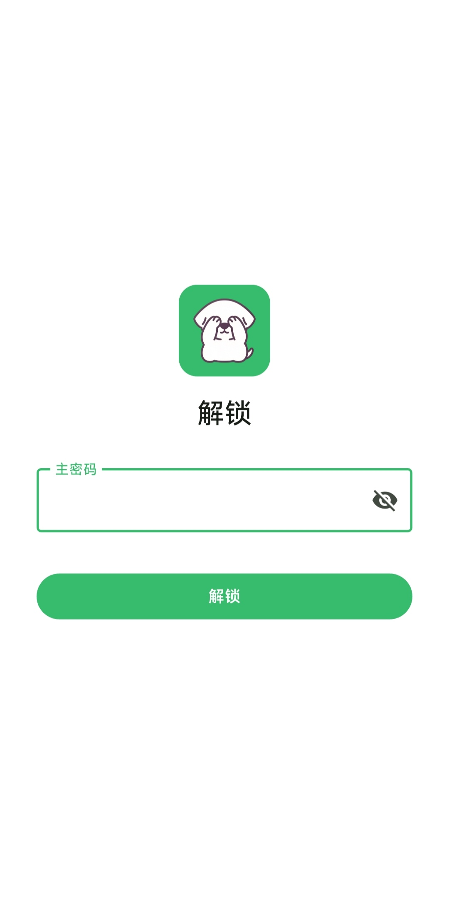
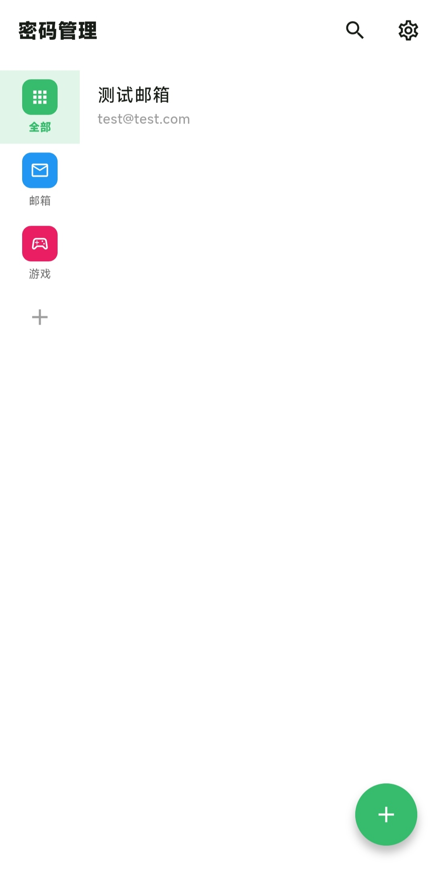
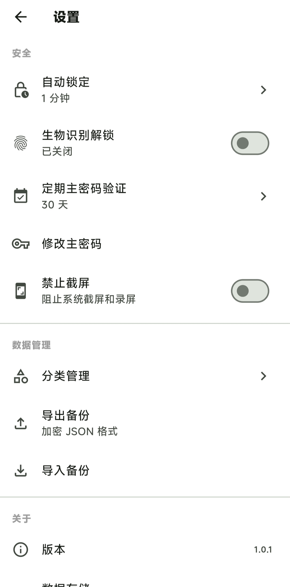

<div align="center">

# LocalPwd · 本地密码管理器

**纯本地存储、无网络权限的 Android 密码管理器**

数据只存在你的手机上 —— 不上传、不同步、不联网。

[](https://flutter.dev)
[](https://www.android.com)
[]()
[]()
[]()

</div>

---

## ✦ 应用截图

<div align="center">
  
  
  
</div>

## ✦ 特性

| 类别 | 说明 |
| --- | --- |
| 🔐 加密存储 | AES-256-GCM 字段级加密 + SQLCipher 全库加密（含元数据） |
| 🗝 密钥层级 | 主密码 → Argon2id 派生 KEK → 加密随机 DEK；改密码只需重加密 32 字节 DEK |
| 👆 多种解锁 | 主密码 / 生物识别（仅生物识别，无图案、PIN 回退） |
| ⏰ 定期验证 | 默认 30 天强制验证一次主密码，之后恢复生物识别 |
| 📝 条目管理 | 标题、用户名、密码、网址、备注、自定义字段、收藏、分类 |
| 🗂 分类管理 | 自定义名称、颜色、图标，拖拽排序 |
| 🫥 隐藏模式 | 独立触发字符串 + 独立密码 + 独立数据，与普通模式完全隔离 |
| 🎲 密码生成器 | 可配置长度与字符集，密码强度实时提示 |
| 🛡 安全防护 | 切后台遮罩、超时自动锁定、锁屏后重新验证、剪贴板 30 秒自动清除 |
| 📦 加密备份 | 仅支持加密 JSON 导出/导入；隐藏模式数据单独导出 |

## ✦ 隐藏模式：如何进入

隐藏模式是一个**与普通模式完全隔离**的独立密码空间：不同的密码、不同的数据、不同的导出文件。入口刻意做到「不可见」——界面上没有任何按钮能进入它。

1. 在首页点击**搜索栏**；
2. 输入**触发字符串**（默认 `##secret`），然后回车；
3. 输入**隐藏模式独立密码**（默认 `000000`）；
4. **首次进入**会强制要求修改触发字符串与独立密码（至少 6 位）——请务必修改并牢记。

进入后，可在「隐藏模式设置」中随时修改触发字符串与密码、管理隐藏分类、单独导出/导入隐藏备份。隐藏数据在普通模式下**不可见、不可搜索、不可导出**。

## ✦ 技术栈

| 用途 | 选型 |
| --- | --- |
| 界面 / 路由 / 状态 | Flutter + GetX |
| 本地数据库 | Drift + sqlcipher_flutter_libs |
| 加密 | cryptography（Argon2id 64MB/4轮 · AES-256-GCM） |
| 密钥存储 | flutter_secure_storage（EncryptedSharedPreferences） |
| 生物识别 | local_auth |

## ✦ 构建

```bash
flutter pub get
flutter build apk --release
```

release 签名从 `android/key.properties` 读取（该文件与 `*.jks` 已被 `.gitignore` 排除）。若未提供，构建会回退到 debug 签名并打印警告——**仅供本地测试，请勿分发**。

`key.properties` 格式：

```properties
storePassword=***
keyPassword=***
keyAlias=***
storeFile=../keystore/release.jks
```

## ✦ 目录结构

```
lib/
├── app/            路由与主题
├── core/
│   ├── constants/  常量与预设
│   ├── crypto/     加密服务（Argon2id / AES-GCM / KEK+DEK）
│   ├── models/     数据模型
│   ├── services/   认证、锁定、导出、剪贴板等
│   ├── storage/    Drift 数据库 / 表 / DAO
│   └── utils/      工具（图标映射、通知）
├── modules/        按功能划分的页面与控制器（home / hidden / entry / category / settings ...）
└── widgets/        复用组件
```

## ✦ 安全

- 安全模型与威胁边界详见 [SECURITY.md](SECURITY.md)
- 漏洞请通过 **GitHub 私有漏洞报告**（Security → Report a vulnerability）私下反馈，请勿直接开公开 Issue
